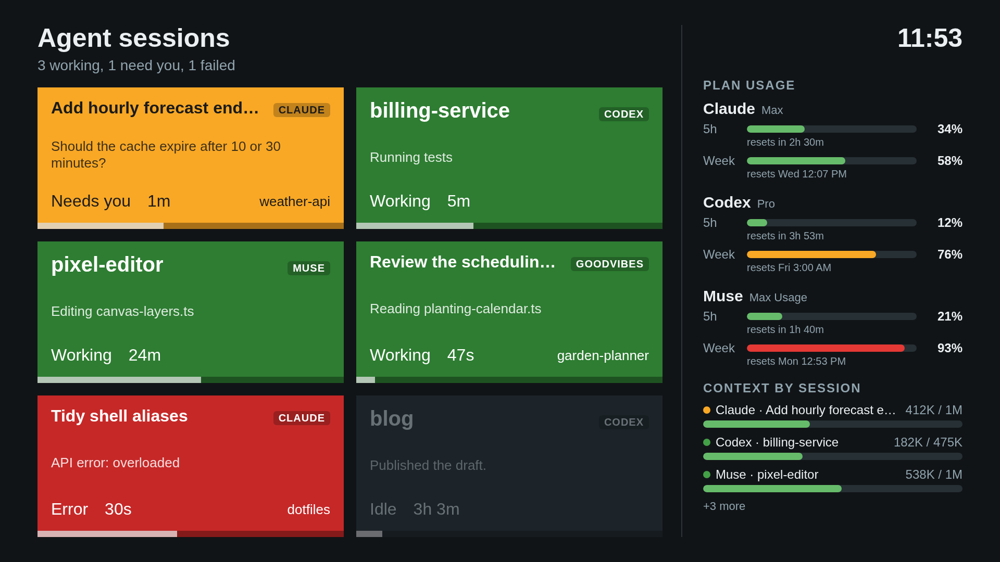

<h1 align="center">LG Agent Monitor</h1>

<p align="center">
  
</p>

<p align="center">
  <b>Every AI coding agent you have open, on your LG TV: which one is working, which one needs you, and how much of your plan is left.</b>
</p>

<p align="center">
  <a href="LICENSE"></a>
</p>

Each open session is a card: green while it works, yellow when it waits for you, red when it failed, dimmed once it
has been idle for hours. A card names the tool, the session's title and folder, what the agent is doing right now (or
what it asked you), how long it has been in that state, and a bar for context-window usage. The right third of the
screen shows how much of each subscription's 5-hour and weekly limits is used, and the context of every session.

This is a fork of [rokuagents](https://github.com/jonsykes/rokuagents) by Jon Sykes, which is itself a fork of
[managents](https://github.com/tonylook/managents) by Antonio Alvino. See [Credits](#credits).

## Supported agents

| Agent | Status | What it is doing | Context | Plan limits |
|---|---|---|---|---|
| [Claude Code](https://claude.com/claude-code) | yes | yes | yes | 5-hour and weekly |
| Codex | yes | yes | yes | 5-hour and weekly |
| Muse Code | yes | yes | yes | 5-hour and weekly |
| GoodVibes | yes | yes | yes | none (no subscription) |
| OpenCode | yes | no | no | none |

Where each number comes from, all read on your computer:

| Agent | Sessions and status | Plan limits |
|---|---|---|
| Claude Code | `~/.claude/sessions` and transcripts | `api.anthropic.com/api/oauth/usage` with Claude Code's own login, every minute |
| Codex | running `codex` processes, `~/.codex` state database and rollouts | `rate_limits` in the newest rollout, no network |
| Muse Code | running `muse-bin-*` processes, `~/.local/share/muse` session index and logs | `api.meta.ai/muse-code/key` with the Muse CLI's login, every 5 minutes |
| GoodVibes | the GoodVibes daemon (`127.0.0.1:3421`), each session's transcript journal and recovery file | none |

## How it works

```
Claude Code, Codex,   managents serve ──── HTTP, your LAN ────> LG TV app (webOS)
Muse, GoodVibes  ───> reads session files    GET /state, once      draws the cards
(your computer)       and plan usage         a second, with a      and the panel
                                             token
```

- **`managents serve`** runs on your computer. It detects the sessions, works out each one's status and activity,
  polls plan usage, and answers `GET /state` with JSON. Requests need a bearer token. The format is in
  [docs/http-api.md](docs/http-api.md), plus a `usage` array for the panel.
- **The webOS app** in [`webos/`](webos/README.md) polls that address once a second. A small service bundled with it
  finds your computer again with a LAN broadcast when its address changes, and asks the TV to hold off its
  screensaver while the app is open.

## What you need

- **A computer** with the agents you use. Developed on Linux; the upstream helper also supports macOS.
- **Go 1.26 or newer** to build the helper.
- **An LG webOS TV, rooted, with the [Homebrew Channel](https://github.com/webosbrew/webos-homebrew-channel) and SSH
  enabled.** Built for an 86NANO90UNA (webOS 5.6). Other webOS TVs should work.
- **Node.js**, so the build can fetch LG's `ares-package` through `npx`.

## Get started

1. **Build the helper**, or download it from the [latest release](../../releases/latest):

   ```sh
   cd helper && go build -o ~/bin/managents ./cmd/managents
   ```

2. **Create a token and start the server:**

   ```sh
   mkdir -p ~/.config/managents
   (umask 077; openssl rand -hex 16 > ~/.config/managents/token)
   MANAGENTS_TOKEN=$(cat ~/.config/managents/token) ~/bin/managents serve --addr :8787
   ```

   If a firewall is on, open TCP and UDP 8787 to your LAN only, for example
   `sudo ufw allow from 192.168.0.0/24 to any port 8787`.

3. **Build and install the TV app.** The address and token are baked into the package, so build it yourself:

   ```sh
   cd webos
   TV_IP=YOUR_TV_IP TV_PASS=your-root-password ./build.sh http://YOUR_COMPUTER_IP:8787 "$(cat ~/.config/managents/token)"
   ```

   Details, including a manual install, are in [webos/README.md](webos/README.md).

## Using it

- Six cards per page. Left/right, up/down, or channel up/down turn pages; it returns to the first page after 30 seconds.
- The panel lists sessions until it runs out of room, then counts the rest.
- Back closes the app.

## Privacy

The server sends each session's folder name, title, status, age, context usage and a short activity line, plus your
plans' usage percentages. Titles and activity lines come from your conversations, so anyone who can see the TV can read
them: start the server with `--titles=false` or `--activity=false` to leave them out.

To read plan limits the helper uses the logins Claude Code and the Muse CLI already keep on your computer, and sends
them only to Anthropic and Meta respectively. Muse's usage call also mints an inference key, which the helper discards
without storing. Traffic to the TV is plain HTTP on your network, protected by the token.

## Also in this repository

Everything from upstream still works: the Roku channel in [`roku/`](roku/README.md), the macOS menu bar app in
[`macos/`](macos/README.md), and the managents USB desk display (firmware, enclosure and `managents run`). The
rokuagents README is kept at [docs/upstream-rokuagents-README.md](docs/upstream-rokuagents-README.md).

## Credits

- **[managents](https://github.com/tonylook/managents)** by **Antonio Alvino**: the original USB desk display for AI
  coding agents, its Go helper, session detection for Claude Code, Codex and OpenCode, and the serial protocol.
- **[rokuagents](https://github.com/jonsykes/rokuagents)** by **Jon Sykes**: the fork this repository forks. It added
  `managents serve` (the HTTP API and LAN discovery), the Roku channel and the macOS app. The card design on the TV
  follows its Roku channel.
- **[CodexBar](https://github.com/steipete/CodexBar)** by **Peter Steinberger**: how to read Muse Code's subscription
  usage ([docs/muse.md](https://github.com/steipete/CodexBar/blob/main/docs/muse.md)).
- **[webOS Homebrew Channel](https://github.com/webosbrew/webos-homebrew-channel)**, which makes sideloading and the
  root service possible.

Built with [gopsutil](https://github.com/shirou/gopsutil), [modernc.org/sqlite](https://gitlab.com/cznic/sqlite) and the
other components listed in [THIRD_PARTY_NOTICES.md](THIRD_PARTY_NOTICES.md). Released under the [MIT license](LICENSE).

Claude and Claude Code are trademarks of Anthropic, Codex of OpenAI, Muse of Meta, LG and webOS of LG Electronics, and
Roku of Roku, Inc. This project is not affiliated with any of them.
